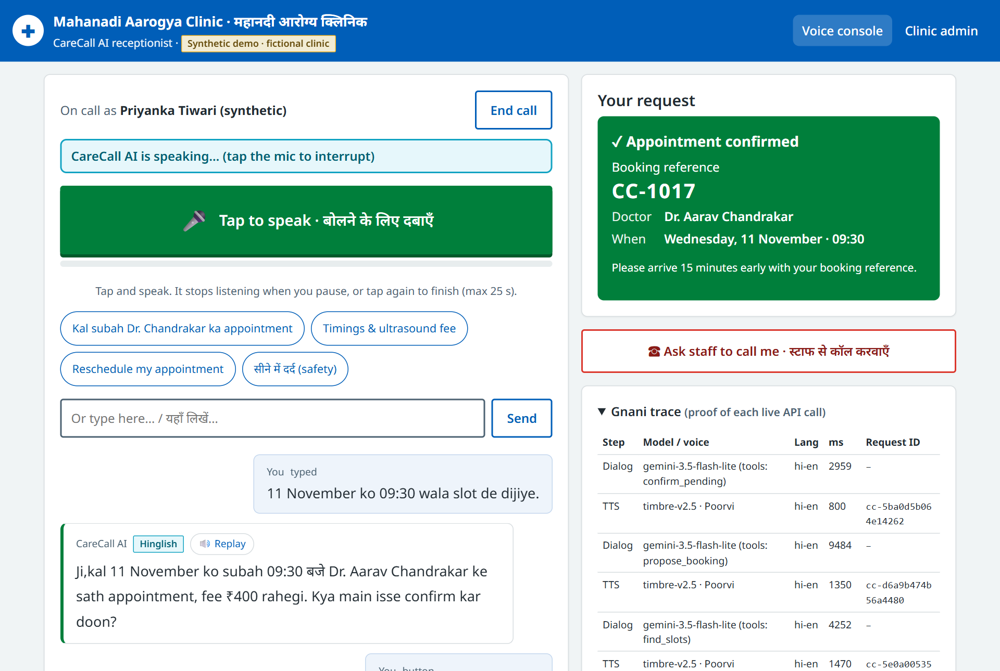
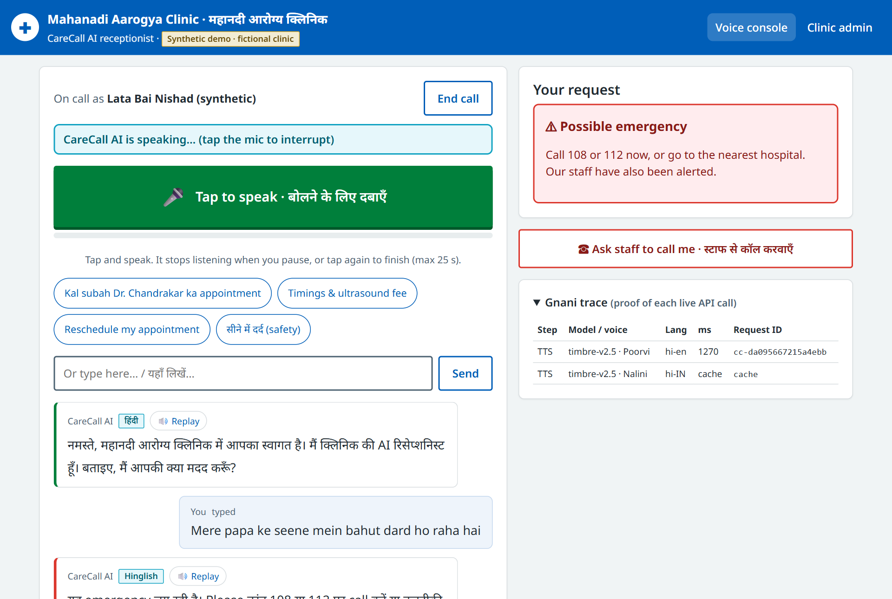
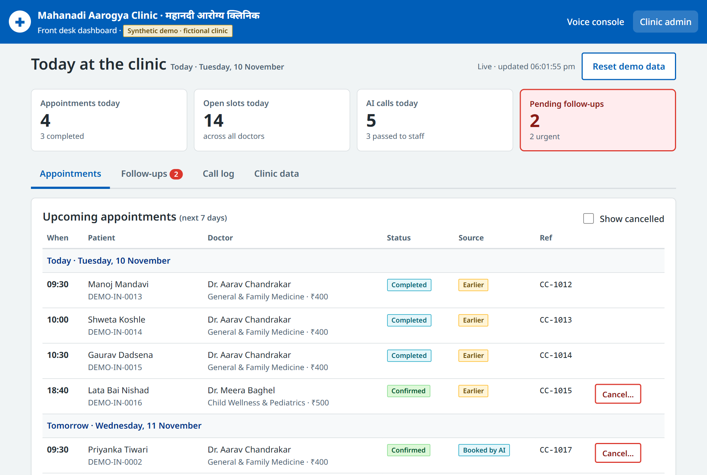
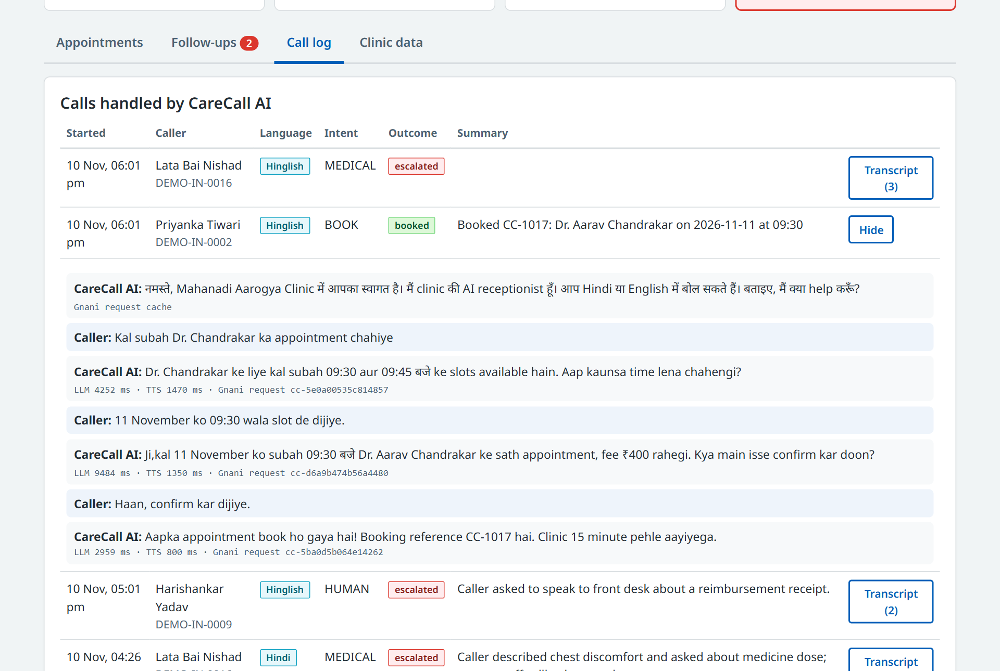
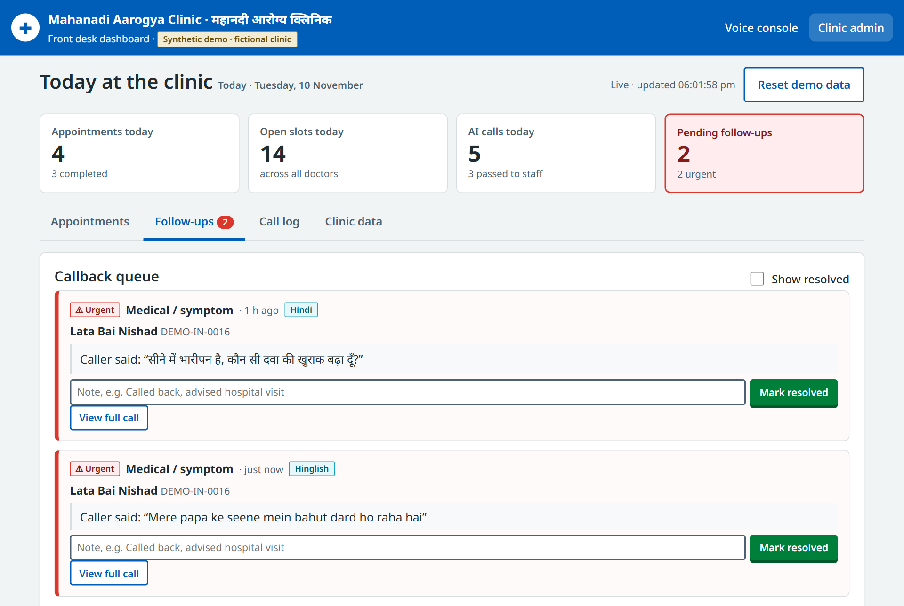
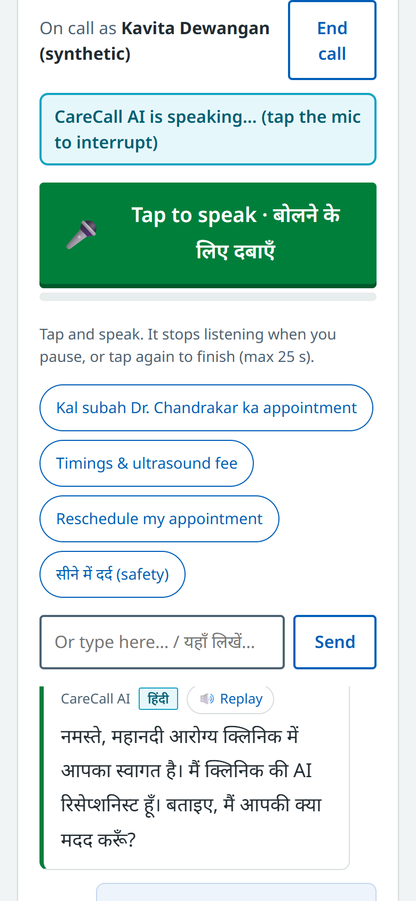

# CareCall AI

A voice receptionist for small clinics that people can talk to the way they actually talk: Hindi, English, the usual mix of both, or any of eight more Indian languages.


I built this for Gnani.ai's Great Indian AI Internship Challenge. The speech side runs on **Gnani Prisma v3.0** (speech-to-text) and **Gnani Timbre v2.5** (text-to-speech).

**Live demo:** https://carecall-ai-ivcd.onrender.com. It's behind an access code (the free Gnani credits are real money for me). If you're evaluating, the code is in my submission. It's on a free server, so the first load can take about a minute to wake up.

> Everything here is fake on purpose: a fictional clinic in Raipur, made-up doctors and patients with `DEMO-IN-0001` style IDs. No real phone numbers anywhere.



---

## Why

Most small clinics I know run on one receptionist doing five things at once. During the morning rush the phone just rings out, and the patient calls the next clinic on Google. Most of those calls are the same few questions: is the doctor in today, what's the fee, can I come at 10:30. That seemed like a good job for a voice agent, as long as it stays out of anything medical.

## What it does

You tap the mic and speak. For example:

> **You:** Kal subah Dr. Chandrakar ka appointment chahiye
> **CareCall:** Dr. Chandrakar ke liye kal subah 09:30 aur 09:45 baje ke slots available hain. Aap kaunsa time lena chahengi?
> **You:** Pehla wala
> **CareCall:** Kal 11 November ko subah 09:30 baje Dr. Aarav Chandrakar ke saath appointment, fee ₹400. Confirm kar doon?
> **You:** Haan
> **CareCall:** Aapka appointment book ho gaya hai. Booking reference CC-1017.

The booking shows up on the clinic's dashboard a couple of seconds later.

It can also:
- answer questions about timings, fees, address, reports and fasting before blood tests, using only what's in the clinic's data;
- cancel or move your own appointment;
- pass you to staff whenever you ask for a person.

If you mention something like chest pain, it doesn't try to help medically. It tells you to call 108 or 112 and raises an urgent ticket for the front desk:



## The front desk side

The admin page shows today's numbers, upcoming appointments, a callback queue and every call with its full transcript. It refreshes every few seconds, so you can watch a booking land while the call is still going.



Each turn in the call log shows how long speech-to-text, the LLM and text-to-speech took, plus the Gnani request ID. I added that mostly so I could debug, but it's also a nice way to show the APIs are really being called.



Staff can also cancel appointments (with a reason), mark a doctor on leave so the bot stops offering that day, and edit the FAQ answers the bot uses.

| Callback queue | On a phone |
|---|---|
|  |  |

## Languages

It speaks every language that Gnani's Prisma and Timbre support. You pick one before the call, or choose Auto-detect and just start talking.

| Language | Prisma code | Timbre voice |
|---|---|---|
| Hinglish | `hi-IN,en-IN` | Poorvi |
| Hindi | `hi-IN` | Nalini |
| English | `en-IN` | Kaveri |
| Marathi | `mr-IN` | Zahira |
| Bengali | `bn-IN` | Kirra |
| Gujarati | `gu-IN` | Falak |
| Punjabi | `pa-IN` | Mehuli |
| Tamil | `ta-IN` | Trisha |
| Telugu | `te-IN` | Lavanya |
| Kannada | `kn-IN` | Saanvi |
| Malayalam | `ml-IN` | Reshma |

How it works:
- All of this lives in one table, `app/languages.py`. Voices, the prompt, the picker in the browser and the tests all read from it, so adding a language is one row plus its phrases.
- Prisma gets the call's language plus English (for example `ta-IN,en-IN`), because people say "appointment" and "cancel" in every language. Auto-detect sends `indic-auto`.
- If you switch language in the middle of a call, the reply switches too. The script of what you said decides it. Hindi and Marathi share a script, so there I look at everyday words like "आहे" and "है".
- The emergency rule, the "no medical advice" rule and the yes/no check before a booking exist in every language, in code.

**The honest part:** Hindi, English and Hinglish are the ones I tested by ear and tuned. I don't speak the other eight. For those I checked two things with `scripts/language_check.py`: Timbre speaks a sentence and Prisma has to transcribe the same sentence back (all eight came back 99–100% the same), and a full booking has to go through the real LLM in that language (all eight did). The fixed sentences in those languages still need a native speaker to read them.

## How Gnani fits in

**Prisma v3.0** (`POST /stt/v3`) transcribes every turn:
- I send the call's language plus English, e.g. `language_code=hi-IN,en-IN`, so one model handles Hindi, English and the mix.
- `format=transcribe` turns spoken numbers into digits. "Saadhe das baje" comes back as `10:30`, which makes booking much more reliable.
- The doctors' surnames go in as `keyterms`. I first tried full names, but that made Prisma insert words nobody said, so it's surnames only now.

**Timbre v2.5** (`POST /api/v1/tts/inference`) speaks every reply. I listened to a few voices and went with **Poorvi** for Hinglish; she handles the mixed script really well. Pure Hindi replies use Nalini and English ones use Kaveri; the other languages each have their own voice (table above).

Between the two, Gemini 3.5 Flash-Lite runs the conversation using function calling. Gnani's own LLM, Evon, isn't on their API platform yet, so I couldn't use it. If you add a Groq key, it falls back to Groq's free tier whenever Gemini rate-limits. Otherwise the caller just gets a polite "please say that again".

## Things that broke along the way

- **Times read the wrong way.** Timbre's docs say to send numbers as words, so I wrote a converter (`app/tts_text.py`). The first version would have read the LLM's "01:30" as *raat dedh baje* (1:30 at night) for a clinic that closes at 8 pm. It now looks at the words around the time and at the clinic's hours, so it comes out as *dopahar dedh baje*.
- **Audio lengths.** Timbre's WAV files come back with the length fields set to `0xFFFFFFFF`. Some browsers then show the wrong duration or refuse to play. I patch the header before sending the audio to the browser.
- **One request at a time.** Gnani can limit an account to one active request, so every call goes through a single lock, with retries on 429 and 5xx errors.
- **Gemini's quota.** The free tier of the model I started with turned out to allow only 20 requests a day, and I burnt through it in one test run. I moved to Flash-Lite, which allows 15 requests a minute.
- **A safety rule that missed real speech.** My rule caught "seene mein dard" but not "seene mein *bahut* dard". The LLM still escalated it, but only as a normal callback. The rule now allows a few words in between, and there's a test for it.

## Safety rules (in code, not just in the prompt)

- **Medical red flags skip the LLM completely.** These are things like chest pain, can't breathe, fainting, heavy bleeding, or someone asking which medicine to take. The caller gets a fixed reply and staff get an urgent ticket.
- **Nothing is booked in the same turn it's suggested.** The bot can only propose. The booking happens on a later turn, and only if the caller actually said yes (or tapped Confirm). Saying "nahi" drops it.
- **No double bookings.** A unique index in SQLite makes them impossible. There's a test where 10 callers race for the same slot, and exactly one gets it.
- **Callers can only touch their own appointments.**
- **Audio is never saved.** Phone, Aadhaar and PAN-looking numbers are scrubbed from transcripts before anything is stored.

## Running it

You need Python 3.12 or newer, a Gnani API key, and a Gemini API key (free from Google AI Studio).

```bash
pip install -r requirements.txt
cp .env.example .env        # then fill in GNANI_API_KEY and GEMINI_API_KEY
python -m uvicorn app.main:app --port 8000
```

Then open http://localhost:8000 for the voice console and http://localhost:8000/admin.html for the dashboard. The browser only allows the microphone on `localhost` or HTTPS.

Set `GNANI_MOCK=1` in `.env` if you want to work on the UI without spending credits.

## Tests

```bash
python -m pytest -q                       # 418 tests, Gnani is mocked, no credits used
python scripts/eval_dialog.py --pace 8    # 14 real conversations against the LLM
python scripts/language_check.py          # every language against real Prisma, Timbre and the LLM
```

The scenario script is the one I trust most. It plays out real conversations against the actual LLM and checks what ended up in the database:
- Hinglish and English bookings, and a caller who changes their mind;
- cancel and reschedule;
- a doctor on leave, an unknown doctor, a Sunday request;
- an emergency, and a medicine question.

All 14 pass on Flash-Lite.

## Code layout

```
app/
  main.py          FastAPI app
  gnani.py         Prisma / Timbre client (lock, retries, cache, WAV fix)
  dialog.py        conversation engine, tools, confirmation gate
  languages.py     the one table of supported languages and voices
  phrases.py       fixed replies and button phrases in every language
  safety.py        emergency / medical / "talk to a person" rules
  booking.py       slots and booking, cancel, reschedule
  tts_text.py      numbers and times into spoken Hindi / English
  llm.py           Gemini + OpenAI-compatible fallback
  seed.py          the fictional clinic
web/               voice console and admin page (plain JS, no build step)
tests/             pytest suite
scripts/           eval + API check scripts
```

## What's missing / next

- **A real phone line.** Right now it's browser only. I looked at Exotel and Twilio, but getting an Indian number that streams audio needs KYC and a few days. The code is split so the same pipeline can sit behind a phone call.
- **Speed.** Each turn takes 3–5 seconds because speech-to-text, the LLM and text-to-speech run one after another. Gnani's streaming endpoints should cut a big chunk of that.
- **Native-speaker review.** Eight of the eleven languages were checked by machine round trip, not by a person who speaks them. The safety sentences especially need that review before anyone relies on them.
- **Free-tier limits.** When the LLM's free tier is busy, a turn can be slow or ask you to repeat.

## License

MIT
